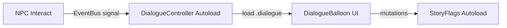

# Godot 4 Dialogue Systems Agent Skill

> **Clasificación**: Skill Especializada (Godot 4 / GDScript 2.0) — Instalable en `.skill/godot-dialogue-plugin-agent-skill/`.

## 📌 Propósito y Alcance

Estandariza sistemas de diálogo en Godot 4 (Dialogue Manager 2/3, Yarn Spinner o grafos `.tres`): GDScript 2.0 tipado (`snake_case`), desacoplamiento por señales/EventBus, mutaciones seguras de `story_flags` y localización `.csv`/`.po`.

## ⚡ $-Comandos

| Comando | Acción | Descripción |
|---|---|---|
| `$dialogue` | Bootstrap | Activa reglas de diálogos en Godot 4. |
| `$dialogue:audit` | Auditoría | Detecta ramas huérfanas, mutaciones no registradas, señales sin desconectar y textos sin clave i18n. |
| `$dialogue:i18n` | Localización | Verifica claves `tr()` / `.po` / `.csv` en líneas de diálogo. |

## 🧩 Arquitectura / Diagrama de Flujo



## ⚡ Quick Start

```bash
git submodule add git@github.com:Agent-Rules-Ecosystem/godot-dialogue-plugin-agent-skill.git .skill/godot-dialogue-plugin-agent-skill
```

Invoca `$dialogue` para activar la habilidad o `$dialogue:audit` para generar el reporte en `overview/work/skill/godot-dialogue-plugin.md`.
