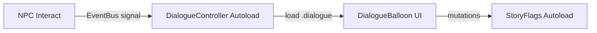

# Godot 4 Dialogue Systems Agent Skill

## Matriz de Capacidades



## Protocolo de Auditoría (`$dialogue:audit`)

1. Inspeccionar archivos `.dialogue`/`.tres` buscando títulos/ramas huérfanas o saltos a nodos inexistentes.
2. Verificar que el globo de diálogo bloquee/restaure el input del jugador limpiamente en `dialogue_ended`.
3. Comprobar desconexión de señales en `_exit_tree()` y claves de localización presentes.
4. Persistir hallazgos en `overview/work/skill/godot-dialogue-plugin.md`.

## Patrón Técnico Canónico

```gdscript
class_name DialogueController
extends Node

signal dialogue_started(resource_path: String)
signal dialogue_finished(resource_path: String)

var is_active: bool = false

func start_dialogue(res: Resource, title: String = "start") -> void:
	if is_active:
		return
	is_active = true
	dialogue_started.emit(res.resource_path)
```

## 📝 Persistencia y Salida Activa

Guardar resultados de auditoría en `overview/work/skill/godot-dialogue-plugin.md` con el esquema estándar:

| ID | Tipo | Estado | Resumen | Evidencia/Ruta | Acción Requerida |
|---|---|---|---|---|---|
| `s1` | `auditoria` | `activo` | Hallazgo concreto | `ruta/archivo#L10` | Corrección sugerida |
